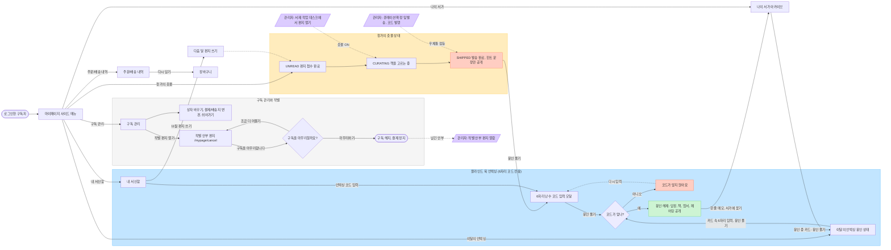

# 우분투북스 사용자 웹사이트 이용 흐름도 (v3.3)

- 근거 자료
  - 명세: Google Drive `KANT/teamprj_front/spec/ubuntu-books-spec-v3.3`
  - 화면: `KANT/teamprj_front/ui-v1/desktop`의 UI 이미지 30장 (`00_스타일가이드` ~ `29_관리자_작별안부편지`)
- FigJam (KRN 팀): https://www.figma.com/board/Zzx8lEs52mIYSKHAsxL0C9
- 이전 버전: [v3.2 흐름도](./ubuntubooks-user-flow.md)
- 표기
  - 실선: 화면에 있는 버튼·링크로 이동
  - 점선: 조건부 이동, 비동기 상태 변화, 관리자가 일으키는 변화
  - `(추정)`: 명세나 화면에 직접 나오지 않아 흐름을 가정한 부분

## v3.2 대비 바뀐 흐름

| 구분 | v3.2 (ui-v0) | v3.3 (ui-v1) |
| --- | --- | --- |
| 접근 권한 | 별도 규칙 없음 | 결제, 구독 신청·편지, `/mypage/**`는 회원 전용 (명세 2장) 비회원이 진입하면 `/auth/signin`으로 리다이렉트되고 `callbackUrl`이 보존됨 |
| 장바구니 | 로그인 상태 화면만 있음 | 비회원도 담기·조회 가능 (기기에 저장, 로그인하면 회원 장바구니로 합쳐짐) 버튼은 "로그인하고 주문하기" |
| 로그인 | `06_로그인` 한 화면 | `/auth/signin`의 로그인 탭과 회원가입 탭 리다이렉트 안내 문구와 `callbackUrl=/cart` 표시 |
| 언박싱 | 6자리 코드 또는 QR | 6자리 고유 난수 코드만 사용 (QR 제거) |
| 페어링 먹거리 | 해금 전 힌트와 함께 노출 | 해금 후에만 공개 |
| 관리자 데스크 | 좌우 2열, 해금 코드 미리 표시 | 단일 세로 스크롤 3단계 "큐레이션 확정 및 발송"을 누를 때 코드가 발행됨 |
| GNB | - | 모든 화면 오른쪽 끝에 햄버거(≡) 아이콘 추가 (모바일 대응) |

## 1. 진입 · 탐색 · 장바구니 · 회원 인증 · 정기구독 가입

```mermaid
flowchart LR
    visit(["방문자 진입"])
    home["홈 /"]
    about["브랜드 스토리 /about"]

    subgraph shop ["테마 서가와 장바구니 (비회원 허용)"]
        shelf["테마 서가 /bookshelf"]
        detail["도서 상세 /bookshelf/id"]
        restock["재입고 알림"]
        cart["장바구니 /cart"]
    end

    orderGuard{"로그인 되어 있나?"}

    subgraph checkoutSg ["회원 주문결제"]
        checkout["주문결제: 배송지, 결제수단"]
        tossPay[["토스페이먼츠 결제"]]
        orderDone["주문 완료 (UI 없음)"]
    end

    subgraph auth ["회원 인증 /auth/signin"]
        signin["로그인 탭"]
        signup["회원가입 탭"]
        verify[["소셜 또는 이메일 링크 인증"]]
        callback{"callbackUrl 있나?"}
    end

    subgraph subscribe ["정기구독 가입 (회원 전용)"]
        plan["1. 플랜 선택 /subscription"]
        subGuard{"로그인 되어 있나?"}
        shipPay["2. 배송지 및 정기결제"]
        tossBilling[["토스 카드 자동결제 등록"]]
        letter["3. 편지 쓰기 /subscription/letter"]
        sent["4. 편지 전송 완료"]
    end

    myCandle(["마이페이지: 창가의 촛불"])
    myMailbox(["마이페이지: 내 서신함"])
    myOrders(["마이페이지: 주문/배송 내역"])

    visit --> home
    home -->|"GNB 브랜드 스토리"| about
    home -->|"테마 카드, 서가 보기"| shelf
    home -->|"추천 도서"| detail
    home -->|"편지로 구독 시작하기"| plan
    home -->|"GNB 로그인"| signin
    about -->|"테마 서가 둘러보기"| shelf
    about -->|"편지로 구독 시작하기"| plan

    shelf -->|"도서 카드"| detail
    shelf -.->|"품절 도서"| restock
    shelf -->|"장바구니 아이콘"| cart
    detail -->|"장바구니 담기, 바로 구매하기"| cart
    cart -.->|"품절 상품"| restock
    cart -->|"주문하기"| orderGuard
    orderGuard -->|"예"| checkout
    orderGuard -->|"아니오: 로그인하고 주문하기"| signin
    checkout -->|"결제하기"| tossPay
    tossPay --> orderDone
    orderDone -.-> myOrders

    plan -->|"배송지 입력하기"| subGuard
    subGuard -->|"예"| shipPay
    subGuard -->|"아니오"| signin
    shipPay -->|"결제하고 편지 쓰러 가기"| tossBilling
    tossBilling --> letter
    letter -->|"우체통에 편지 넣기"| sent
    sent -->|"나의 창가 보러 가기"| myCandle
    sent -->|"보낸 편지 다시 읽기"| myMailbox

    signin -->|"회원가입 탭"| signup
    signin -->|"카카오, 네이버, 로그인 링크 받기"| verify
    signup -->|"소셜 시작, 가입하고 인증 메일 받기"| verify
    verify --> callback
    callback -->|"/cart, 장바구니 병합"| checkout
    callback -->|"구독 신청 중"| shipPay
    callback -->|"없음 (추정)"| myCandle

    style shop fill:#C2E5FF,stroke:#3DADFF
    style checkoutSg fill:#C6FAF6,stroke:#5AD8CC
    style auth fill:#DCCCFF,stroke:#874FFF
    style subscribe fill:#FFECBD,stroke:#FFC943
    style orderGuard fill:#FFE0C2,stroke:#FF9E42
    style subGuard fill:#FFE0C2,stroke:#FF9E42
    style restock fill:#D9D9D9,stroke:#B3B3B3
    style orderDone fill:#D9D9D9,stroke:#B3B3B3
    style myCandle fill:#CDF4D3,stroke:#66D575
    style myMailbox fill:#CDF4D3,stroke:#66D575
    style myOrders fill:#CDF4D3,stroke:#66D575
```

## 2. 구독 이후 마이페이지 (회원 전용 /mypage/**)

## 화면 ↔ 흐름 노드 매핑 (ui-v1/desktop)

| UI 이미지 | 흐름 노드 | 경로 |
| --- | --- | --- |
| 01_홈 | 홈 | `/` |
| 02_브랜드스토리_about | 브랜드 스토리 | `/about` |
| 03_테마서가_bookshelf | 테마 서가 | `/bookshelf?theme=` |
| 04_도서상세_bookshelf-id | 도서 상세 | `/bookshelf/[id]` |
| 05_장바구니_비로그인_cart | 장바구니 → "로그인하고 주문하기" | `/cart` |
| 06_장바구니_회원주문결제_cart | 주문결제: 배송지, 결제수단 | `/cart` (회원) |
| 07_로그인_리다이렉트_auth-signin | 로그인 탭 | `/auth/signin?callbackUrl=/cart` |
| 08_회원가입_auth-signin | 회원가입 탭 | `/auth/signin` |
| 09_구독안내_플랜선택 | 1. 플랜 선택 | `/subscription` (Public) |
| 10_구독신청_배송_정기결제 | 2. 배송지 및 정기결제 | (경로 미정, 회원 전용) |
| 11_편지쓰기_letter | 3. 편지 쓰기 | `/subscription/letter` (회원 전용) |
| 12_편지전송완료 | 4. 편지 전송 완료 | (경로 미정) |
| 13~15_마이_창가의촛불_UNREAD/CURATING/SHIPPED | 창가의 촛불 상태 3종 | `/mypage` |
| 16_마이_내서신함_mailbox | 내 서신함 | `/mypage/mailbox` |
| 17_마이_언박싱_봉인상태_unboxing | 이달의 언박싱 봉인 상태 | `/mypage/unboxing` |
| 18_마이_언박싱_코드입력모달 | 6자리 난수 코드 입력 모달 | `/mypage` 위 모달 |
| 19_마이_언박싱_해금후 | 봉인 해제 | `/mypage/unboxing` |
| 20_마이_나의서가_archive | 나의 서가 아카이브 | `/mypage/archive` |
| 21_마이_주문배송내역_orders | 주문/배송 내역 | `/mypage/orders` |
| 22_마이_구독관리 | 구독 관리 | (경로 미정) |
| 23_마이_작별안부편지_cancel | 작별 안부 편지 | `/mypage/cancel` |
| 24_마이_작별_확인팝업 | 구독을 마무리할까요? | `/mypage/cancel` 위 팝업 |
| 25~29_관리자_* | 관리자 노드 (상태 변화 원인만 표시) | `/admin/*` |

## 확인이 필요한 부분

1. **callbackUrl이 없을 때 로그인 후 이동할 곳**
   - GNB 로그인처럼 callbackUrl 없이 로그인한 경우의 목적지는 명세에 없습니다.
   - 로그인 화면 부제("나의 창가와 서가를 확인하세요")를 근거로 마이페이지로 이동한다고 가정했습니다.
2. **구독 신청 시 로그인을 요구하는 시점**
   - 명세에는 "정기구독 신청 및 편지 에디터 진입"이 회원 전용이라고만 되어 있습니다.
   - 그래서 "배송지 입력하기"를 누르는 순간 인증을 검사한다고 가정했습니다.
   - 이 경로에서 쓰이는 callbackUrl 값은 화면에 없습니다.
3. **회원가입 이후 이동할 곳**
   - "가입하고 인증 메일 받기" 이후 화면이 없습니다.
   - 흐름도에서는 로그인과 같은 인증 단계로 합쳐서 표시했습니다.
4. **햄버거(≡) 메뉴**
   - 데스크톱 시안에도 있지만 메뉴 내용이 없어 흐름에 넣지 않았습니다.
   - 스타일가이드 설명으로는 모바일 하단 탭바(홈·서가·구독·장바구니·마이)와 같은 진입점입니다.
5. **화면 이미지가 없는 단계 (v3.2와 동일)**
   - 주문 완료, 해지 완료
   - 코드 오류 상태: 문구 "코드가 맞지 않아요"는 스타일가이드에만 있습니다.
   - 쉬어가기, 결제수단·배송지 변경 이후 화면
