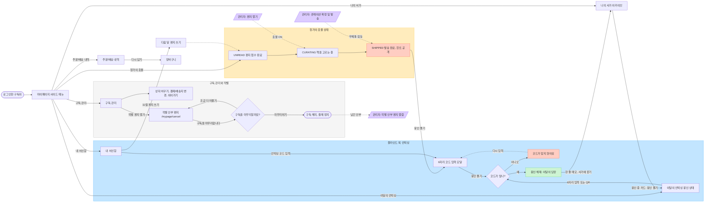

# 우분투북스 사용자 웹사이트 이용 흐름도

- 근거 자료
  - 명세: Google Drive `KANT/teamprj_front/ubuntubooks spec v3.2`
  - 화면: 같은 폴더 `ui-v0`의 UI 이미지 28장 (`00_스타일가이드` ~ `27_관리자_작별안부편지`)
- 표기
  - 실선: 화면에 있는 버튼·링크로 이동
  - 점선: 조건부 이동, 비동기 상태 변화, 관리자가 일으키는 변화
  - `(UI 없음)`: 명세나 버튼에는 나오지만 `ui-v0`에 해당 화면 이미지가 없는 단계

## 1. 진입 · 탐색 · 일반 구매 · 정기구독 가입

```mermaid
flowchart LR
    visit(["방문자 진입"])
    home["홈 /"]
    about["브랜드 스토리 /about"]

    subgraph shop ["테마 서가와 일반 구매"]
        shelf["테마 서가 /bookshelf"]
        detail["도서 상세 /bookshelf/id"]
        restock["재입고 알림"]
        cart["장바구니 및 주문결제 /cart"]
        tossPay[["토스페이먼츠 결제"]]
        orderDone["주문 완료 (UI 없음)"]
    end

    subgraph subscribe ["정기구독 가입 4단계"]
        plan["1. 플랜 선택 /subscription"]
        authCheck{"로그인 되어 있나?"}
        shipPay["2. 배송지 및 정기결제"]
        tossBilling[["토스 카드 자동결제 등록"]]
        letter["3. 편지 쓰기 /subscription/letter"]
        sent["4. 편지 전송 완료"]
    end

    login["로그인: 카카오, 네이버, 이메일 링크"]
    myCandle(["마이페이지: 창가의 촛불"])
    myMailbox(["마이페이지: 내 서신함"])
    myOrders(["마이페이지: 주문/배송 내역"])

    visit --> home
    home -->|"GNB 브랜드 스토리"| about
    home -->|"테마 카드, 서가 보기"| shelf
    home -->|"추천 도서"| detail
    home -->|"편지로 구독 시작하기"| plan
    home -->|"GNB 로그인"| login
    about -->|"테마 서가 둘러보기"| shelf
    about -->|"편지로 구독 시작하기"| plan

    shelf -->|"도서 카드"| detail
    shelf -.->|"품절 도서"| restock
    shelf -->|"장바구니 아이콘"| cart
    detail -->|"장바구니 담기, 바로 구매하기"| cart
    cart -.->|"품절 상품"| restock
    cart -->|"결제하기"| tossPay
    tossPay --> orderDone
    orderDone -.-> myOrders

    plan -->|"배송지 입력하기"| authCheck
    authCheck -->|"아니오"| login
    authCheck -->|"예"| shipPay
    login -->|"구독 진행 중"| shipPay
    login -->|"일반 로그인"| myCandle
    shipPay -->|"결제하고 편지 쓰러 가기"| tossBilling
    tossBilling --> letter
    letter -->|"우체통에 편지 넣기"| sent
    sent -->|"나의 창가 보러 가기"| myCandle
    sent -->|"보낸 편지 다시 읽기"| myMailbox

    style shop fill:#C2E5FF,stroke:#3DADFF
    style subscribe fill:#FFECBD,stroke:#FFC943
    style authCheck fill:#FFE0C2,stroke:#FF9E42
    style restock fill:#D9D9D9,stroke:#B3B3B3
    style orderDone fill:#D9D9D9,stroke:#B3B3B3
    style myCandle fill:#CDF4D3,stroke:#66D575
    style myMailbox fill:#CDF4D3,stroke:#66D575
    style myOrders fill:#CDF4D3,stroke:#66D575
```

## 2. 구독 이후 마이페이지 (창가의 촛불 · 언박싱 · 나의 서가 · 해지)

## 화면 ↔ 흐름 노드 매핑

| UI 이미지 | 흐름 노드 | 경로 (명세 6장) |
| --- | --- | --- |
| 01_홈 | 홈 | `/` |
| 02_브랜드스토리_about | 브랜드 스토리 | `/about` |
| 03_테마서가_bookshelf | 테마 서가 | `/bookshelf?theme=` |
| 04_도서상세_bookshelf-id | 도서 상세 | `/bookshelf/[id]` |
| 05_장바구니_주문결제_cart | 장바구니 및 주문결제 | `/cart` |
| 06_로그인 | 로그인 | (경로 미정) |
| 07_구독안내_플랜선택 | 1. 플랜 선택 | `/subscription` |
| 08_구독신청_배송_정기결제 | 2. 배송지 및 정기결제 | (경로 미정) |
| 09_편지쓰기_letter | 3. 편지 쓰기 | `/subscription/letter` |
| 10_편지전송완료 | 4. 편지 전송 완료 | (경로 미정) |
| 11~13_마이_창가의촛불_UNREAD/CURATING/SHIPPED | 창가의 촛불 상태 3종 | `/mypage` |
| 14_마이_내서신함_mailbox | 내 서신함 | `/mypage/mailbox` |
| 15_마이_언박싱_봉인상태_unboxing | 이달의 언박싱 봉인 상태 | `/mypage/unboxing` |
| 16_마이_언박싱_코드입력모달 | 6자리 코드 입력 모달 | `/mypage` 위 모달 |
| 17_마이_언박싱_해금후 | 봉인 해제: 이달의 답장 | `/mypage/unboxing` |
| 18_마이_나의서가_archive | 나의 서가 아카이브 | `/mypage/archive` |
| 19_마이_주문배송내역_orders | 주문/배송 내역 | `/mypage/orders` |
| 20_마이_구독관리 | 구독 관리 | (경로 미정) |
| 21_마이_작별안부편지_cancel | 작별 안부 편지 | `/mypage/cancel` |
| 22_마이_작별_확인팝업 | 구독을 마무리할까요? | `/mypage/cancel` 위 팝업 |
| 23~27_관리자_* | 관리자 노드 (상태 변화 원인만 표시) | `/admin/*` |

## 확인이 필요한 부분 (UI·명세에 없음)

1. **로그인을 요구하는 시점**
   - 화면 08부터는 로그인 상태로 그려져 있습니다.
   - 06 로그인 화면에는 "처음이신가요? 편지로 구독 시작하기" 링크가 있습니다.
   - 그래서 흐름도에는 "배송지 입력하기" 직전에 로그인을 확인하는 분기를 가정해 넣었습니다.
2. **비회원 주문**
   - 명세의 `POST /api/v1/orders`는 비회원 주문을 허용합니다.
   - 그런데 05 장바구니 화면에는 로그인 상태만 그려져 있습니다.
   - 그래서 장바구니 앞에는 로그인 분기를 두지 않았습니다.
3. **화면 이미지가 없는 단계**
   - 주문 완료
   - 해지 완료
   - 코드 오류 상태: 문구 "코드가 맞지 않아요"는 00 스타일가이드에만 있습니다.
   - QR 전용 진입: 명세 경로 `/my-letter/unlock?code=`
   - 쉬어가기, 결제수단·배송지 변경 이후 화면
   - 주문 취소 확인 팝업
4. **편지를 쓰지 않은 달**
   - 07 화면에는 "쓰지 않으면 지난 편지를 바탕으로 책을 골라준다"는 안내가 있습니다.
   - 이 규칙은 흐름도에 표시하지 않았습니다.
